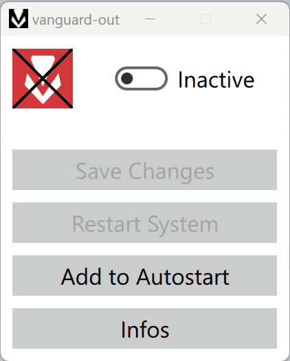

# vanguard-out

Tool to temporarily stop and disable Riot Vanguard.


> [!WARNING]
> **Warning:**
> With the release of [Vanguard on-demand](https://www.riotgames.com/en/news/vanguard-on-demand), this tool is deprecated, but it will still remain available here for others.  
> Be aware that Vanguard is a kernel-level tool with higher privileges than your own user account.  
> Read this: [Why You Should Reconsider Playing League of Legends: The Risks of Kernel-Level Anti-Cheat Software](https://gist.github.com/stdNullPtr/2998eacb71ae925515360410af6f0a32).

## Features

Inspired by [@AndrewMast](https://gist.github.com/AndrewMast) scripts: [Commands to temporarily stop Riot Vanguard](https://gist.github.com/AndrewMast/742ac7e07c37096017e907b0fd8ec7bb#file-readme-md).  
If you don't like that Riot Vanguard is running in the background on your system all the time, just stop and disable it.  
The tool is not perfect, but it does the job. Feedback and suggestions are welcome.

- Disable vanguard and stop from the tray.
- Re-enable it when you want to play (restart system required).
- Add shortcut to startup folder, so vanguard is locked out on every system start.
- Restart system command included.
- Use a small command line interface.
- Or use a simple user interface.

## vanguard-cli

```bash
Usage: vanguard-cli.exe [OPTIONS]

Options:
  -h,--help                                       Print this help message and exit
  -v,--version                                    Display program version information and exit
  -s,--state {activate, deactivate} or {1, 0}     Set vanguard state
  -r,--restart INT:POSITIVE                       Restart system after N seconds (default: 0)
  -c,--check                                      Check current state and activate or deactivate vanguard
```

### Usage

```bash
activate:                 vanguard-cli.exe --state activate
deactivate:               vanguard-cli.exe --state deactivate
activate with restart:    vanguard-cli.exe --state activate --restart
```

### Shortcut for Startup folder with PowerShell commands

```powershell
$WshShell = New-Object -ComObject WScript.Shell;
$ShortcutPath = "$env:APPDATA\Microsoft\Windows\Start Menu\Programs\Startup\vanguard-cli.lnk";
$Shortcut = $WshShell.CreateShortcut($ShortcutPath);
$Shortcut.TargetPath = "C:\tools\vanguard-out-0.1.0-win64\vanguard-cli.exe";
$Shortcut.WorkingDirectory = "C:\tools\vanguard-out-0.1.0-win64";
$Shortcut.Arguments = "--check";
$Shortcut.Save();
```

### Used Commands

#### Activate

```bash
sc config vgc start= demand & sc config vgk start= system
net start vgc
powershell Set-ItemProperty -Path "HKLM:\Software\Microsoft\Windows\CurrentVersion\Run" -Name "Riot Vanguard" -Value "C:\Program Files\Riot Vanguard\vgtray.exe"

```

#### Deactivate

```bash
sc config vgc start= disabled & sc config vgk start= disabled & net stop vgc & net stop vgk & taskkill /IM vgtray.exe
powershell Remove-ItemProperty -Path "HKLM:\Software\Microsoft\Windows\CurrentVersion\Run" -Name "Riot Vanguard"
```

## vanguard-gui

Uses the [Qt Quick Controls Universal Style](https://doc.qt.io/qt-6/qtquickcontrols-universal.html).



## Installation

- Tested on Windows 11 with Qt version 6.11.1 MinGW.
- For the portable version download the latest release from [github/vanguard-out/releases](https://github.com/Simon-12/vanguard-out/releases) and unzip it.
- To build from source, you can also download the source code from releases.
- `vanguard-cli`: no Qt required, dependencies listed below.
- `vanguard-gui`: the easiest way is to open `CMakeLists.txt` in your Qt Creator and configure with one of your installed Qt kits.

### Dependencies

| Library | Description |
| --- | --- |
| [CLI11](https://github.com/CLIUtils/CLI11) | Header-only C++11 command-line argument parser — handles flags, options, subcommands, and help generation |
| [mINI](https://github.com/metayeti/mINI) | Tiny header-only library for reading and writing `.ini` configuration files |
